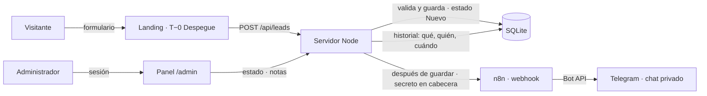

# Campuslands AI Academy · Reto 4 — Registro, aviso por Telegram y seguimiento

Cuando alguien pide información desde la landing, el registro se guarda, el equipo recibe un aviso en Telegram (vía **n8n**) y cualquier administrador puede continuar el seguimiento desde un panel con estados, notas e historial.

> **Relación con el Reto 3.** Este proyecto parte de una **copia** de la landing entregada en el Reto 3 (etiqueta `reto-3-final` del repositorio [`Nic-tolb/landing-ai-academy`](https://github.com/Nic-tolb/landing-ai-academy)). El Reto 3 no se modificó: tiene su propio repositorio, documentación y despliegue (https://nic-tolb.github.io/landing-ai-academy/). Este repositorio solo añade lo del Reto 4.

## Recorrido



| Requisito oficial                                                         | Dónde                                                                  |
| ------------------------------------------------------------------------- | ---------------------------------------------------------------------- |
| Formulario: nombre, correo, programa (obligatorios) y teléfono (opcional) | `src/components/LeadForm.astro`, `src/client/features/lead-form.ts`    |
| Validación, registro con fecha y estado **Nuevo**, confirmación           | `server/validate.mjs`, `server/db.mjs`, `POST /api/leads`              |
| Aviso por Telegram con n8n (nombre, correo, programa, teléfono si existe) | `automation/workflow-n8n.json`, `server/notify.mjs`                    |
| Panel con acceso de administrador                                         | `server/admin/`, `server/auth.mjs`                                     |
| Estados Nuevo, Contactado, En seguimiento, Cerrado + notas                | `PATCH /api/admin/leads/:id/status`, `POST /api/admin/leads/:id/notes` |
| Historial: qué cambió, quién y cuándo                                     | tabla `events`; el autor sale de la sesión, nunca del cliente          |
| Dato obligatorio inválido → sin registro ni aviso                         | validación en servidor (422) antes de guardar; pruebas QA-10/11        |

## Stack y decisiones

- **Landing:** Astro 7 + TypeScript (la del Reto 3) con el formulario añadido en la fase **T−0 · Despegue**. Los programas son las cinco misiones reales.
- **Servidor:** Node 24 con `node:http`, sin frameworks. **Base de datos:** SQLite con `node:sqlite` (incluido en Node; persistente en `data/`). Sin dependencias nuevas que instalar ni servicios de pago.
- **Seguridad:** contraseñas con `scrypt`; sesión en cookie `HttpOnly` + `SameSite=Strict` (en la base solo se guarda el hash del token); cabecera propia obligatoria en mutaciones (CSRF); límite de peticiones por IP en el registro y el acceso; validación en servidor; trampa anti-bots; consultas parametrizadas; el panel inserta texto con `textContent` (sin HTML del usuario).
- **Automatización:** n8n 1.123 en Docker. Webhook protegido con secreto compartido; token y chat de Telegram como variables de entorno de n8n (el JSON exportado no contiene secretos).
- **Fallos:** el aviso se envía **después** de guardar. Si n8n o Telegram fallan, el registro se conserva con aviso «fallido» (visible en el panel y en el historial), se reintenta al arrancar el servidor y con el botón «Reintentar aviso». El servidor solo da por enviado un aviso si n8n confirma `{ "ok": true }`. No se reenvía un aviso ya enviado, y un doble envío del formulario no crea dos registros (clave de idempotencia).

## Requisitos previos

- Node ≥ 22.23.4 (probado con Node 24) y npm.
- Docker (para n8n).
- Un bot de Telegram propio (creado con @BotFather) y un chat privado con él.

## Instalación y ejecución

```bash
npm install
cp .env.example .env     # completa N8N_WEBHOOK_SECRET con un valor aleatorio (≥ 16 caracteres)
```

**1 · Telegram.** Crea el bot con @BotFather, escríbele cualquier mensaje desde tu cuenta y guarda el token en `.env.telegram` (no se sube al repositorio):

```
TELEGRAM_BOT_TOKEN=123456:ABC...
```

```bash
node scripts/n8n.mjs telegram-chat   # detecta tu chat privado y guarda TELEGRAM_CHAT_ID
node scripts/n8n.mjs test-telegram   # (opcional) mensaje de prueba directo
```

**2 · n8n.**

```bash
node scripts/n8n.mjs start           # contenedor en http://localhost:5690 con los secretos como variables
```

Abre http://localhost:5690, crea la cuenta de propietario, **importa** `automation/workflow-n8n.json` (menú ⋯ → _Import from file_), guárdalo y **actívalo**. El webhook de producción queda en `http://localhost:5690/webhook/ai-academy-lead` (el valor de `N8N_WEBHOOK_URL`).

**3 · Administradores** (la contraseña va por variable de entorno, nunca en el código):

```bash
ADMIN_EMAIL=evaluador@aiacademy.test ADMIN_NAME="Evaluador AI Academy" ADMIN_PASSWORD='una-clave-larga' npm run admin:create
```

**4 · Servidor.**

```bash
npm run serve            # compila la landing y arranca en http://localhost:8787
```

- Landing: http://localhost:8787 (formulario en la sección **T−0 · Despegue**).
- Panel: http://localhost:8787/admin/

## Verificación (guion de la demo oficial)

1. Abre la landing, llena el formulario con datos ficticios y envía → aparece «¡Gracias…! Guardamos tu solicitud».
2. En Telegram llega «Nuevo interesado · AI Academy» con nombre, correo, programa y teléfono (si se dio).
3. Entra al panel, localiza el registro (búsqueda o métrica «Nuevos»), ábrelo, márcalo **Contactado** y añade una nota.
4. Vuelve a la lista y ábrelo de nuevo (o recarga, o cierra sesión y vuelve a entrar): el estado, la nota y el historial —con autor y hora— siguen ahí.
5. Caso inválido: correo `nombre@correo` → el formulario muestra el error, el servidor responde 422, **no** aparece en el panel y **no** llega aviso.

Pruebas automáticas:

```bash
npm run test:server      # servidor: registro, validación, idempotencia, fallo de Telegram, sesión, estados, notas, historial, persistencia, límite por IP
npm test                 # además, las pruebas unitarias heredadas de la landing
```

## Problemas frecuentes

| Síntoma                                  | Causa y solución                                                                                                                         |
| ---------------------------------------- | ---------------------------------------------------------------------------------------------------------------------------------------- |
| Aviso «Falló · n8n no confirmó el envío» | Token o chat de Telegram vacíos o incorrectos en n8n. Revisa `.env.telegram`, ejecuta `node scripts/n8n.mjs start` y «Reintentar aviso». |
| Aviso «Falló · n8n respondió HTTP 404»   | El workflow no está activo en n8n. Actívalo.                                                                                             |
| Aviso «Falló · HTTP 401»                 | El secreto de `.env` y el del contenedor de n8n no coinciden. Ejecuta de nuevo `node scripts/n8n.mjs start`.                             |
| Puerto 5690 u 8787 ocupado               | Cambia `PORT` en `.env` o el puerto en `scripts/n8n.mjs` (y `N8N_WEBHOOK_URL`).                                                          |

## Limitaciones conocidas

- La demo corre en un equipo con Node y Docker; el enlace público, si existe, es un túnel temporal (ver «Enlaces y accesos» en la carpeta de entrega).
- El límite de peticiones vive en la memoria del proceso (suficiente para una instancia).
- Sin recuperación de contraseña: los administradores se crean con `npm run admin:create`.

## Estructura

```
server/          servidor, base de datos, autenticación, avisos y panel (server/admin/)
automation/      workflow de n8n exportado (JSON)
scripts/         utilidades de n8n/Telegram (y de recursos de marca heredadas del Reto 3)
src/             landing (Reto 3) + formulario del Reto 4
docs/            documentación heredada del Reto 3 (diseño de la landing)
```

Proyecto hecho con Claude (Anthropic) como asistente de desarrollo, dirigido y revisado en cada paso.
